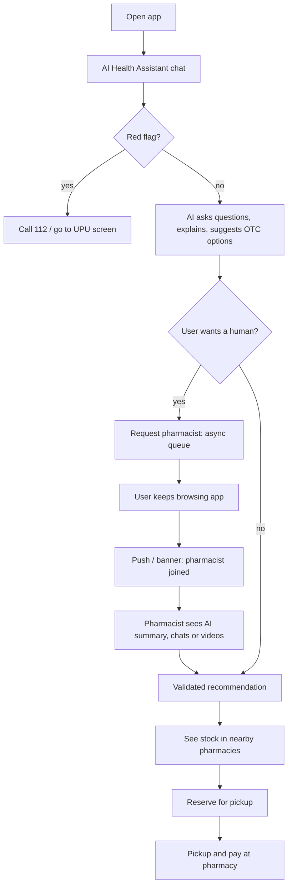

# LDS — Local Distribution System for Pharmacy & Medicine (Romania)

> **Status:** Brainstorming / design phase. No code yet, on purpose.
> We agree on the design and the SOAR first, then lock the stack.

---

## 1. One-liner

**A mobile app (Android + iOS) where an AI assistant helps you understand your symptoms and suggests what to do. At any moment you can connect to a real pharmacist who already has your case summary. You can also see which pharmacy has your medicine in stock and reserve it for pickup.**

Long-term, it's a **shared distribution layer for medicine**: one common protocol that pharmacies and chains connect to once, making stock and professional advice accessible across apps.

---

## 2. Decisions taken so far

| Topic | Decision |
|---|---|
| Starting vertical | **Pharmacy** (human). Vet, clinics, hospitals come later. |
| Pilot | **Family pharmacy chain**. Start small, real pharmacies and pharmacists from day one. |
| Consultation model | **AI first**: the AI handles the conversation and the recommendation. The user can **request a human** (pharmacist / assistant / later doctor), who joins **with the AI-generated summary**. |
| Commerce | **Stock visibility** per pharmacy + **medicine reservation** for pickup. |
| Platform | **Native-feeling phone app for Android and iOS**. |
| Backend requirement | **Scalable, fast, async-first** (chat connecting in the background while the user navigates the app, live stock, notifications). |
| Who pays | **Launch free** for everyone, measure traction, then decide (options in §9). The pilot chain covers the running costs. |
| Pilot size | **2–3 pharmacies** of the family chain (good: small and controllable). |
| Reservations | **OTC**: reserve and pay at pickup. **Rx**: the user registers the prescription in the app, reserves, and **presents the prescription at the counter** to get the medicine. |
| Pharmacist availability | **Minimal model**: the pharmacy team answers from the counter during **08:00–20:00**. Outside those hours: AI + callback request. **No on-call.** See [docs/03](docs/03-pharmacist-availability.md). |
| Who answers in the app | **Pharmacists and pharmacy assistants**, like at the counter. Assistants can transfer to a pharmacist. |
| Stock integration | Pending verification of how the chain's software exposes stock. MVP fallback: CSV upload + manual flags. See [docs/11](docs/11-stock-integration.md). |
| Backend language | **Rust** (Axum + Tokio). |
| Mobile | **Flutter** (Android + iOS from one codebase). |
| Regulatory | Regulatory adviser to confirm the AI / telepharmacy / reservation rules **before launch**. |
| Process | **Design first**: diagrams, UML and documentation in [docs/](docs/README.md) before any code. |

---

## 3. The problem

1. **People don't know what to do.** Someone feels unwell (often at night), has medicines at home, and doesn't know what's safe to take or where to go.
2. **The pharmacist starts from zero** and re-asks the same questions.
3. **"Does any pharmacy have it?"** People call or drive between pharmacies looking for a product. There's no cross-pharmacy stock view and no simple reservation.
4. **UPU (emergency rooms) are overloaded** with minor cases a pharmacist could handle.
5. **Pharmacies are fragmented.** Independents have no digital channel. Each chain runs its own closed app.

---

## 4. Product pillars

### 4.1 AI Health Assistant (AI-first consult)
- Guided conversation: symptoms, duration, age, allergies, chronic conditions, current medication, pregnancy, etc.
- Answers **follow-up questions about possible causes / diagnostics** in plain language ("what could this be?", "when should I worry?").
- Suggests **OTC treatment options** and self-care, checks interactions with the medicines the user already takes, and says clearly when a doctor or 112 is needed.
- The user can scan or photograph medicines at home so the AI knows what's available.
- Produces a **structured case summary** (SOAP/SBAR style) that's always kept up to date.

### 4.2 Connect to a human (any time)
- A "Talk to a pharmacist" button is available throughout the AI chat.
- The request goes to the queue of available pharmacists (pilot: family chain staff). Later: other roles (pharmacy assistant, doctor, vet).
- **Async by design:** the user keeps using the app (browsing stock, reserving) while the connection is pending. They get an in-app banner or push notification when the pharmacist joins.
- The pharmacist sees the **AI summary + full transcript + meds at hand** before saying hello. No re-asking.
- Chat, upgradeable to **voice/video** (to show packaging, a rash, etc.).
- The pharmacist can **confirm, adjust or override** the AI's suggestion, then push a **reservation** directly to the user.

### 4.3 Stock & Reservation
- See **which pharmacy has a product** (available / low / not available), sorted by distance and opening hours.
- **Reserve for pickup** with a hold time (e.g., 2–24h) and **pay at the pharmacy** in the MVP (no online payment = less regulation and less complexity).
- Reservation can come from search, from the AI's suggestion, or from the pharmacist.
- The pharmacy gets the reservation in a simple dashboard or tablet app and confirms / prepares it.
- Status updates: *confirmed → ready for pickup → picked up / expired*.

### 4.4 Pharmacies near me
- Map + list, open now / non-stop, route via Google/Apple Maps deep links.
- Phase 2: queue-aware routing (`total time = travel time + queue time`).

### 4.5 Safety layer (non-negotiable)
- A **rule-based red-flag engine runs before and alongside the AI** (chest pain, stroke signs, breathing difficulty, severe allergic reaction, poisoning, suicidal ideation…). It shows an immediate 112 / UPU screen.
- AI guardrails: no Rx prescribing, child/pregnancy/elderly caution rules, and an escalation to a human when confidence is low.

---

## 5. Competitive reference: Doctronic (USA)

| | **Doctronic** | **LDS (us)** |
|---|---|---|
| AI symptom chat | Yes, free, 24/7 | Free, 24/7 |
| AI summary handed to a human | Yes, SOAP note to a doctor | Yes, summary to a **pharmacist** (later doctor) |
| Human consult | Licensed US doctor, video (~\$39/visit or insurance) | **Pharmacist** (chat → video). Cheaper, more accessible, OTC-focused |
| Prescriptions | Doctor sends e-Rx to pharmacy | Not in MVP (OTC focus). Later via partner doctors |
| **Pharmacy stock visibility** | No | Yes |
| **Medicine reservation / pickup** | No | Yes |
| Connected to physical pharmacies | Indirect (e-Rx) | **Direct**: the pharmacy is part of the network |
| Market | USA | Romania → CEE |

**Our differentiation:** Doctronic ends at *advice*. LDS ends at *the medicine in your hand*: advice → human validation → stock → reservation → pickup.

---

## 6. Core user flows

Other flows: direct stock search → reserve (no consult), consult history, family profiles (child, parent), follow-up check-in after X hours.

---

## 7. Actors

- **Patient / caregiver**: mobile app.
- **Pharmacist / assistant**: consult console (tablet / web) with queue, summary, chat and video.
- **Pharmacy staff**: reservation dashboard (confirm, prepare, mark picked up).
- **Chain admin**: pharmacies, staff, schedules, stock sync, analytics.
- **Platform admin**: verification (CFR license), AI safety review, audit.
- *(Later)* Other chains, independents, doctors, vets, channel partners (GDS API).

---

## 8. Distribution Layer Model & Neutrality

The platform is designed as an open, unified distribution network:
- **Pharmacies & Chains (Suppliers):** publish real-time stock, available staff, opening hours.
- **Unified Case & Reservation Protocol:** structured records connecting triage, advice, reservations, and counter fulfillment.
- **Channels & Partners:** patient mobile app, chain apps, insurers, healthcare partners.
- **LDS Open API:** an integration layer that pharmacies and ERPs implement once to be reachable everywhere.

> **Strategic tension:** starting inside the family chain is great for speed, but other chains won't join a platform they see as a competitor's app. → **Separate brand + multi-tenant from day one**, and the chain is "tenant #1".

---

## 9. Who pays? (decision needed)

| Model | How | Pros | Cons | When |
|---|---|---|---|---|
| **A. Chain-funded** | The family chain funds the app as its digital channel. Patients pay nothing | Zero friction for users. ROI measured on reservation sales + loyalty | Cost borne by chain. Looks "chain-owned" | **Pilot (recommended)** |
| **B. Freemium patient** (Doctronic-style) | AI free. Human consult paid (e.g., 15–30 lei) or included in a subscription | Direct revenue | Romanians expect pharmacist advice for free at the counter → low conversion | Test later, maybe for video only |
| **C. Pharmacy SaaS** | Pharmacies pay monthly for profile + stock listing + consult console + reservations | Predictable revenue, scales with network | Requires a network of patients first | Phase 2 (other pharmacies join) |
| **D. Per-reservation fee** | Small fee/commission per completed pickup | Aligned with value (pharmacy pays only when it sells) | Needs reliable pickup tracking | Phase 2 |
| **E. Patient premium** | Family profiles, reminders, chronic meds refill alerts, priority pharmacist | Recurring B2C | Needs strong habit first | Phase 3 |
| **F. B2B Network API** | Insurers, other apps, healthcare partners pay for access | The long-term platform model | Long-term, regulatory care on data | Phase 3+ |
| Sponsored products (rejected) | Brands pay for placement in AI suggestions | — | **Destroys trust and is ethically/legally dangerous** | Never |

**Suggested path:** **A (pilot) → C + D (network) → E + F (scale)**.
**Pilot KPI to justify A:** extra sales from reservations + consult-to-reservation conversion vs. the app's running cost.

---

## 10. SOAR analysis

> **S**trengths · **O**pportunities · **A**spirations · **R**esults

### Strengths
- **Family pharmacy chain = real pilot**: real pharmacists, real stock data, real customers, no sales cycle needed.
- **Distribution network vision**: thinking in terms of open inventory, real-time availability, and instant reservations across providers rather than a closed single-chain shop. That's rare in Romanian health-tech.
- A complete loop no one offers locally: **AI advice → pharmacist validation → stock → reservation → pickup**.
- Pharmacists are licensed, trusted, numerous (~10k pharmacies in RO) and underused as first-line care.
- Software-only and capital-light. Low start cost.

### Opportunities
- **Doctronic proves the model** (AI-first + human handoff) in the US. Nothing equivalent exists in Romania for pharmacies.
- No **neutral cross-pharmacy stock + reservation** platform in Romania.
- UPU overload: public / institutional interest in diverting minor cases.
- Independent pharmacies need digital channels to compete with big chains.
- LLMs make high-quality intake, Q&A and summaries cheap.
- Expansion: vet pharmacies, clinics, insurers, CEE markets, GDS API.

### Aspirations
- *"When someone in Romania feels unwell, they open LDS first: get clear guidance in a minute, talk to a real pharmacist in under 5, and have the medicine reserved at the nearest pharmacy."*
- Become the **standard distribution layer pharmacies connect to**.
- Free or near-free for patients, fair for pharmacies, and **safe above all**.
- Build a high-quality, scalable system.

### Results (pilot targets, to refine)
| Metric | Target |
|---|---|
| Pharmacies live in pilot | All (or N) pharmacies of the family chain |
| Monthly active users after 3 months | TBD (e.g., 1–2k) |
| AI consults resolved without a human | 60–70% |
| Time from "request pharmacist" to joining | **< 5 min** (in staffed hours) |
| Pharmacist re-asked basic questions | **< 20%** of consults |
| Consult → reservation conversion | > 25% |
| Reservations picked up (not expired) | > 80% |
| Red flags routed to 112 | **100%** (safety metric, audited) |
| App rating | ≥ 4.5 / 5 |

---

## 11. Technology options

### 11.1 Mobile app (Android + iOS)

| Option | Language | Pros | Cons | Verdict |
|---|---|---|---|---|
| **Flutter** | Dart | One codebase, near-native performance, beautiful custom UI, strong WebRTC/LiveKit SDKs, maps, push. Very productive | Dart is used only in Flutter. Larger app size | **Top pick** |
| **React Native (Expo)** | TypeScript | Huge ecosystem, TS shared with a web dashboard, LiveKit SDK, OTA updates | Native modules sometimes painful. Performance slightly behind Flutter for heavy UI | Strong alternative |
| **Kotlin Multiplatform + Compose MP** | Kotlin | Shared logic, native feel, can share models with a Kotlin backend | iOS side less mature, smaller community | Good, more risk |
| **Native (Swift + Kotlin)** | Swift, Kotlin | Best possible UX and platform access | **Two apps to build and maintain** | Not for a small team |

The **pharmacist console and reservation dashboard** can be the same Flutter app (tablet/web build) or a separate web app.

### 11.2 Backend (async, scalable, fast)

What the backend must handle concurrently: WebSocket chat, presence (who's online), the consult queue, AI streaming responses, push notifications, stock sync jobs, reservation timers (expiry), video signaling.

| Option | Concurrency model | Performance | Real-time / chat | Dev speed | Learning curve | Notes |
|---|---|---|---|---|---|---|
| **Rust** (Axum + Tokio + SQLx) | async/await on Tokio | 5/5 | 4/5 | 2/5 | Steep | Fastest and safest. Slower to iterate |
| **Go** (chi/Echo/Fiber + goroutines) | Goroutines + channels | 4/5 | 4/5 | 4/5 | Easy | Very pragmatic. Simple to hire for. Great for APIs and websockets |
| **Elixir** (Phoenix + Channels/Presence) | BEAM lightweight processes | 3/5 (latency 5/5) | 5/5 | 4/5 | Medium | **Built for chat/presence** (WhatsApp/Discord-style). Fault tolerant. Niche talent |
| **Kotlin** (Ktor + coroutines) | Coroutines | 4/5 | 4/5 | 4/5 | Medium | Mature JVM. Pairs well with KMP mobile |
| **TypeScript** (NestJS / Fastify) | Event loop | 3/5 | 4/5 | 5/5 | Easy | Fastest MVP, especially with React Native. CPU-bound limits |
| **Python** (FastAPI) | asyncio | 2/5 | 3/5 | 4/5 | Easy | Best AI ecosystem. Use as an **AI microservice**, not the core |

> **Reality check on scale:** even a national pharmacy app means thousands to tens of thousands of concurrent connections. **All of the above can handle that.** The real criteria are **dev speed, reliability, and what you want to learn**. Good async design (queues, pub/sub, push notifications) matters more than raw language speed.

### 11.3 Shared infrastructure (language-independent)
- **PostgreSQL + PostGIS**: data + geo queries ("pharmacies with stock near me").
- **Redis or NATS**: pub/sub, presence, queues, rate limiting.
- **Video/voice:** **LiveKit** (open-source WebRTC SFU, SDKs for Flutter/RN, managed cloud or self-hosted).
- **Push:** FCM (Android) + APNs (iOS).
- **AI:** LLM API (EU data residency) + RAG over a vetted Romanian drug database (prospect/RCP from ANMDMR) + a rule-based red-flag engine in front.
- **Stock sync:** connector to the chain's pharmacy ERP (API, DB replica, or scheduled export).
- **Hosting:** EU region (GDPR, health data).

### 11.4 Candidate combinations

| Combo | Why | Trade-off |
|---|---|---|
| **Flutter + Rust** | Max performance + safety. Modular monolith on Axum/Tokio | Slower MVP. Steeper learning curve |
| **Flutter + Go** | Fastest *robust* path. Simple async with goroutines | Less "fancy" domain modeling |
| **Flutter + Elixir** | Best-in-class real-time chat/presence/queue | Smaller ecosystem/talent |
| **React Native + TypeScript (NestJS)** | One language everywhere. Fastest to first demo | Less performant/robust long-term |

**Decision:** **Flutter** for mobile + **Rust (Axum/Tokio)** for the backend, as a **modular monolith** (not microservices yet). **LiveKit** for video, plus a small **Python AI service** only if needed. See [docs/10-decisions.md](docs/10-decisions.md) (ADR-001, ADR-002).

---

## 12. Risks & constraints

- **AI that "recommends treatment" = regulated.** In the EU, software that gives diagnostic/therapeutic recommendations is likely a **medical device (MDR, Rule 11 → class IIa or higher)** and **high-risk under the EU AI Act**. Options to discuss:
  1. **Human-in-the-loop:** the AI informs, explains and drafts. Treatment recommendations are **validated by a pharmacist** before being final.
  2. AI limited to **general health information + OTC info from official leaflets**, with clear disclaimers. Escalate to a human for anything specific.
  3. Go for **CE certification** later, once the product is proven.
  → **Must validate with a regulatory/legal advisor before launch.**
- **Telepharmacy in Romania:** what a pharmacist may advise remotely, Colegiul Farmaciștilor rules. To verify.
- **Reservations:** OTC reservation with pay-at-pickup is likely simplest. Rx products require the prescription at pickup (e-prescription / CNAS rules). Online *sale* of OTC needs ANMDMR authorization + the EU common logo. To verify.
- **GDPR / health data:** explicit consent, minimization, EU hosting, encryption, audit logs, retention policy, DPIA.
- **Stock accuracy:** show levels (available / low) rather than exact counts. Sync frequency depends on the chain's ERP.
- **Pharmacist availability:** define staffed hours. Outside them, the AI only + "nearest open pharmacy".
- **Neutrality:** a separate brand from the family chain (see §8).

---

## 13. Open questions (next session)

> The full, living list is in [docs/README.md → Open questions](docs/README.md#open-questions).

1. **Stock:** how does the chain's pharmacy software expose stock? Use the checklist in [docs/11](docs/11-stock-integration.md).
2. **Weekends:** same 08:00–20:00 hours? How many team members are on duty per pharmacy? One tablet per pharmacy?
3. **AI scope for MVP:** which regulatory option from §12 (1, 2 or 3)? Recommended: option 1 (human-in-the-loop).
4. **Reservations:** hold time (OTC vs Rx)? Max items per reservation?
5. **Brand:** separate from the chain? Name ideas?
6. **App languages:** Romanian only at first, or also English/Hungarian?

---

## 14. Next steps

- [x] Pick the starting vertical: **pharmacy**
- [x] Pick the pilot: **family chain**
- [x] Pick the consult model: **AI-first + human handoff with summary**
- [x] Who pays (for now): **free launch**, decide after traction
- [x] Backend stack: **Rust**
- [x] Mobile: **Flutter**
- [x] Availability model: **Minimal**, no on-call ([docs/03](docs/03-pharmacist-availability.md))
- [ ] Verify how the chain's software exposes stock ([docs/11](docs/11-stock-integration.md))
- [ ] Review the MVP scope ([docs/02](docs/02-requirements.md))
- [ ] Review the domain model ([docs/05](docs/05-domain-model.md))
- [ ] Review the architecture + async flows ([docs/06](docs/06-architecture.md), [docs/07](docs/07-sequence-diagrams.md), [docs/08](docs/08-state-machines.md))
- [ ] Regulatory check (MDR / AI Act / telepharmacy / reservations) with an adviser
