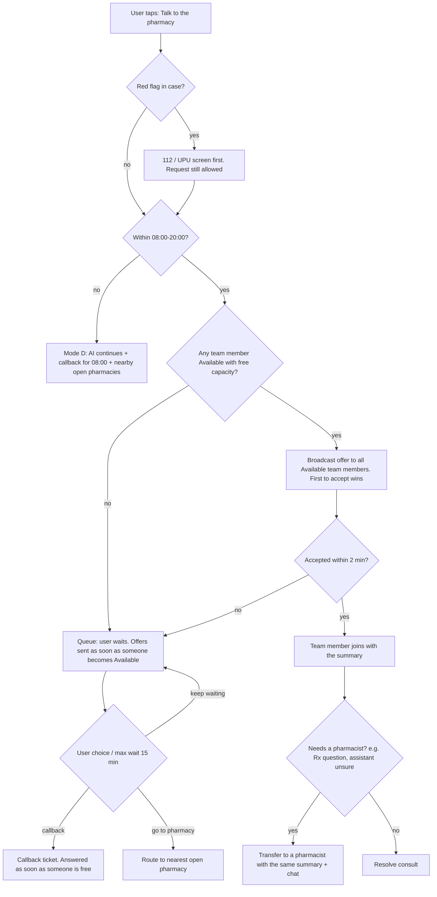

# 03 — Pharmacy Team Availability

> **Goal:** when a user taps **"Talk to the pharmacy"**, a member of the pharmacy team answers fast, without hurting the service at the counter.
> **Context:** pilot = 2–3 pharmacies of the family chain, open **08:00–20:00**.

---

## 1. Decisions

| Topic | Decision |
|---|---|
| Model | **Minimal**: **Mode A (counter + app)** during opening hours, **Mode D (AI + callback)** outside them |
| On-call / free days | **No on-call** in MVP (Mode C moved to *Later*) |
| Dedicated app slot | Not in MVP (Mode B moved to *Later*) |
| Who answers | **Pharmacists and pharmacy assistants**: the app works like the counter, and anyone who may answer at the counter may answer in the app |
| Hours | **08:00–20:00** (to confirm: every day, or different on Saturday/Sunday? → Q2) |
| Extra cost | Zero: staff answer between counter clients |

---

## 2. Modes

### Mode A — Counter + App (08:00–20:00)
- Every team member on duty has the **staff app** (tablet at the counter or work phone).
- They toggle **Available** / **Busy** / **Break**. Going Available is only possible **during opening hours**, and everyone goes **Offline automatically at 20:00**.
- Chat first: the team member replies between clients. Video is optional when the counter is quiet.
- Default limit: **1 active consult per person** (configurable to 2).
- The team works **chain-wide**: a team member from pharmacy X can answer a user who is near pharmacy Y. With 2–3 pharmacies this maximizes the chance someone is free.

### Mode D — AI + Callback (20:00–08:00, or nobody free)
- The AI keeps helping, with stricter red-flag / "see a doctor" thresholds.
- The user can leave a **callback request** with the summary attached. It appears at the top of the queue at **08:00**.
- The app shows **open / non-stop pharmacies nearby** (including outside the chain, from public data) and 112 / UPU info when relevant.
- The app clearly shows: *"The pharmacy team is available daily 08:00–20:00. Next: tomorrow 08:00."*

---

## 3. Who can do what (role permissions)

The default follows the counter: assistants answer questions like they would in person.
**The exact legal scope of pharmacy assistants (asistenți de farmacie) for advice and dispensing must be confirmed by the regulatory adviser** (Q10). That's why permissions are **configurable per role** and not hard-coded.

| Action | Pharmacist | Pharmacy assistant | Notes |
|---|---|---|---|
| Receive & accept consult offers | Yes | Yes | |
| Chat / video with patient | Yes | Yes | |
| See AI summary + transcript | Yes | Yes | Audited |
| Validate / edit AI **OTC** recommendation | Yes | Yes (default, configurable) | Like at the counter |
| Answer questions about Rx medicines | Yes | Configurable | Default: assistant transfers to a pharmacist |
| **Transfer consult to a pharmacist** | — | Yes | New feature (S-13) |
| Propose a reservation | Yes | Yes | |
| Process reservations (confirm, ready, pickup) | Yes | Yes | |
| Verify prescription at Rx pickup | Yes | Configurable | Follows current counter practice |
| Handle callback tickets | Yes | Yes | |

---

## 4. Routing rules

| Rule | MVP value (configurable) |
|---|---|
| Offer strategy | **Broadcast** to all Available team members chain-wide. First accept wins |
| Offer reminder | Re-notify every 2 min while the request is waiting |
| Max wait before suggesting callback | 15 min (the user can keep waiting) |
| Request still waiting at 20:00 | Converted automatically to a callback ticket for 08:00 |
| Queue info to user | Position + rough ETA, or "team busy right now" |
| Callback SLA | Within opening hours: as soon as someone is free. Overnight: by 08:30 |
| Transfer | Assistant → any Available pharmacist. Keeps the full history |

---

## 5. Schedule (MVP)

| Day | 00–08 | 08–20 | 20–24 |
|---|---|---|---|
| Mon–Sun (weekends to confirm) | D | **A** (everyone on duty, pharmacists + assistants) | D |

**No shift planner in MVP.** Availability = *pharmacy open* + *team member toggled Available*. This removes a whole module from the first version. The shift planner returns when Modes B/C are added.

---

## 6. Later options (not in MVP, kept for when data shows demand)

| Mode | Idea | Trigger to reconsider |
|---|---|---|
| **B — Dedicated app slot** | One team member covers the app for all pharmacies for a 2–4h block | Many requests waiting > 5 min during peaks |
| **C — On-call (evenings / free days)** | Voluntary, paid (hybrid: hourly base + per consult), from home. Needs a labor contract addendum | Many callback tickets created after 20:00 / at weekends |
| **Extended hours** | Partner with a non-stop pharmacy | Strong night demand |

---

## 7. What the system needs (→ requirements)

| Feature | Notes |
|---|---|
| Presence toggle | Available / Busy / Break / Offline, gated by opening hours, auto-Offline at closing |
| Heartbeat | Auto-Offline if the staff app disconnects (e.g., tablet asleep) |
| Broadcast offers + reminders | In-app sound + push to the staff device |
| Queue for waiting requests | Offered as soon as someone becomes Available |
| Callback tickets | Overnight queue shown at 08:00 |
| Transfer to pharmacist | Assistant → pharmacist, same case |
| Role permissions | Configurable per tenant (table §3) |
| User-facing availability | "Team available now (N online)" / "Next: tomorrow 08:00" |
| Workload report | Consults per person, response times, waiting times → data to decide on Modes B/C later |

---

## 8. Remaining questions

1. Same 08:00–20:00 hours **on Saturday and Sunday**? Is any pharmacy closed on some days?
2. How many team members (pharmacists / assistants) are on duty per pharmacy at the same time?
3. Will each pharmacy get a **dedicated tablet** for the staff app, or will staff use work/personal phones?
