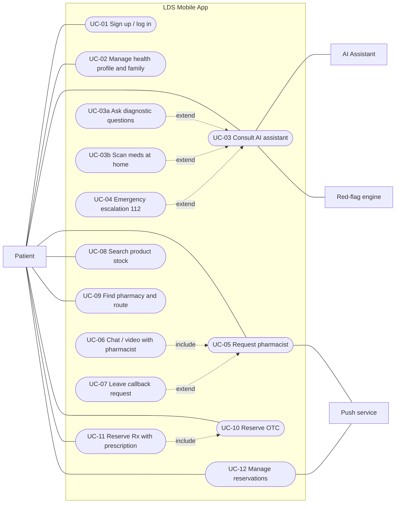
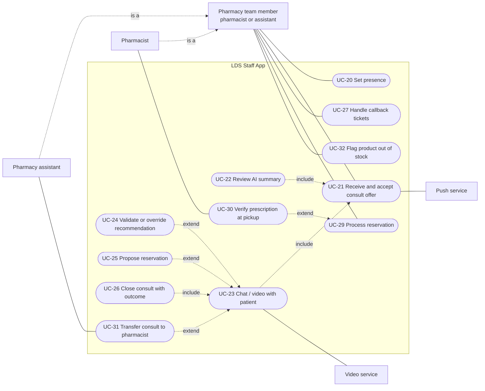
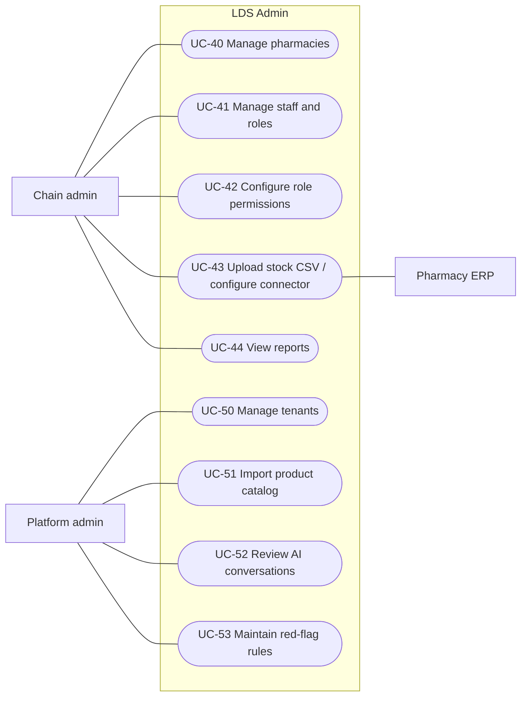

# 04 — Use Cases (UML)

> Mermaid has no native use case diagram, so use cases are drawn as flowcharts:
> actors = rectangles on the sides, use cases = rounded nodes inside the system boundary (subgraph).

---

## 1. Actors

| Actor | Type | Description |
|---|---|---|
| Patient | Primary, human | Uses the mobile app for themselves or a family member |
| Pharmacist | Primary, human | Licensed (CFR). Takes consults, validates recommendations, receives transfers, handles Rx pickup |
| Pharmacy assistant | Primary, human | Answers consults like at the counter (configurable permissions), transfers to a pharmacist |
| Pharmacy team member | Abstract actor | Generalization of Pharmacist + Pharmacy assistant |
| Chain admin | Primary, human | Manages pharmacies, opening hours, staff, role permissions, stock |
| Platform admin | Primary, human | Safety review, tenants, catalog |
| AI Assistant | Secondary, system | LLM-based assistant (external provider) |
| Red-flag engine | Secondary, internal | Rules that detect emergencies |
| Pharmacy ERP | Secondary, system | Source of stock data |
| Push service | Secondary, system | FCM / APNs |
| Video service | Secondary, system | LiveKit |
| Scheduler | Secondary, time | Timers: reservation expiry, offer reminders, opening / closing time (08:00 / 20:00) |

---

## 2. Patient use cases

## 3. Staff use cases

> Generalization: Pharmacist and Pharmacy assistant are both *Pharmacy team members*, so they inherit all the team use cases. UC-30 (Rx verification) is shown for the pharmacist; whether assistants may do it is **configurable** (doc 03 §3, Q10).

## 4. Admin use cases

---

## 5. Use case descriptions (key ones)

### UC-03 Consult AI assistant
| | |
|---|---|
| **Actor** | Patient |
| **Preconditions** | Logged in, health-data consent given |
| **Trigger** | Patient taps "New consultation" |
| **Main flow** | 1. Patient selects the profile (me / family member). 2. Patient describes symptoms. 3. System runs the red-flag engine on the message. 4. System sends the context (profile + history) to the AI. 5. AI streams a reply / follow-up question. 6. Repeat 2–5. 7. AI gives an assessment + OTC/self-care suggestions. 8. System updates the Case summary. |
| **Alternative** | 3a. Red flag detected → UC-04 (112 screen). The case is marked `EMERGENCY_SHOWN`. The patient may still continue or request a human. 5a. AI unavailable → offer UC-05 directly. 7a. AI not confident / out of scope → recommends talking to a pharmacist (UC-05). |
| **Postconditions** | The Case exists with transcript + summary. Suggestions are flagged `pending_validation` if the regulatory option is human-in-the-loop |
| **Req** | P-AI-1..8, SYS-1, SYS-2 |

### UC-05 Request pharmacist (async handoff)
| | |
|---|---|
| **Actor** | Patient |
| **Preconditions** | An open Case |
| **Trigger** | Patient taps "Talk to a pharmacist" |
| **Main flow** | 1. System creates a Consult `REQUESTED` with the latest summary. 2. System checks opening hours (08:00–20:00) and finds **Available** team members (pharmacists + assistants) chain-wide, then broadcasts offers (WebSocket + push). 3. Patient sees the queue banner and may navigate anywhere in the app. 4. A team member accepts → Consult `ACTIVE`. 5. Patient is notified (banner if the app is in the foreground, push otherwise). 6. → UC-06. |
| **Alternative** | 2a. Outside opening hours → Mode D: AI continues + offer UC-07 callback (answered from 08:00) + nearby open pharmacies. 2b. Nobody Available → request waits in the queue and is offered as soon as someone becomes Available. 4a. No accept in 2 min → reminder to staff. After 15 min the patient is offered: keep waiting / callback / route to a pharmacy. 4b. Still waiting at 20:00 → converted to a callback ticket. 3a. Patient cancels → `CANCELLED`. 6a. An assistant transfers to a pharmacist (UC-31). |
| **Postconditions** | Consult is `ACTIVE`, `CALLBACK_PENDING` or `CANCELLED` |
| **Req** | P-HO-1..5, S-3, SYS-6 |

### UC-10 / UC-11 Reserve OTC / Rx
| | |
|---|---|
| **Actor** | Patient |
| **Preconditions** | Logged in. Product available or low at the chosen pharmacy |
| **Main flow** | 1. Patient selects products + pharmacy. 2. If any product is Rx → include UC-11: patient selects or registers a prescription (photo + series/number or e-Rx code). 3. System creates the Reservation `SUBMITTED`. 4. Pharmacy staff confirms → `CONFIRMED` and prepares it → `READY` (hold timer starts). 5. Patient gets the pickup code / QR. 6. At the counter, staff scans the QR. Rx: verifies the original prescription. → `PICKED_UP`. |
| **Alternative** | 4a. Out of stock in reality → `REJECTED` (with reason + alternative suggestion). 6a. Rx prescription invalid → item refused at the counter. 6b. Hold expires → `EXPIRED`. 3a. Patient cancels → `CANCELLED`. |
| **Req** | P-RS-1..7, S-11, S-12, SYS-5 |

### UC-31 Transfer consult to pharmacist
| | |
|---|---|
| **Actor** | Pharmacy assistant |
| **Preconditions** | The assistant has an `ACTIVE` consult |
| **Trigger** | Rx-related question, the assistant is unsure, or a permission requires a pharmacist |
| **Main flow** | 1. Assistant taps "Transfer to pharmacist" (optional note). 2. System broadcasts an offer to Available pharmacists only. 3. The patient sees "A pharmacist will join your conversation". 4. A pharmacist accepts → becomes the consult's assignee and sees the summary + full chat + assistant note. 5. The assistant is released. |
| **Alternative** | 2a. No pharmacist Available → the assistant keeps the consult and the patient is offered a callback from a pharmacist. |
| **Req** | S-13 |

### UC-42 Configure role permissions
| | |
|---|---|
| **Actor** | Chain admin |
| **Main flow** | 1. Admin opens the role permissions page. 2. Toggles what pharmacy assistants may do (validate OTC recommendations, answer Rx questions, verify Rx at pickup). 3. Changes apply immediately to routing and the staff app UI. |
| **Req** | A-8 |
