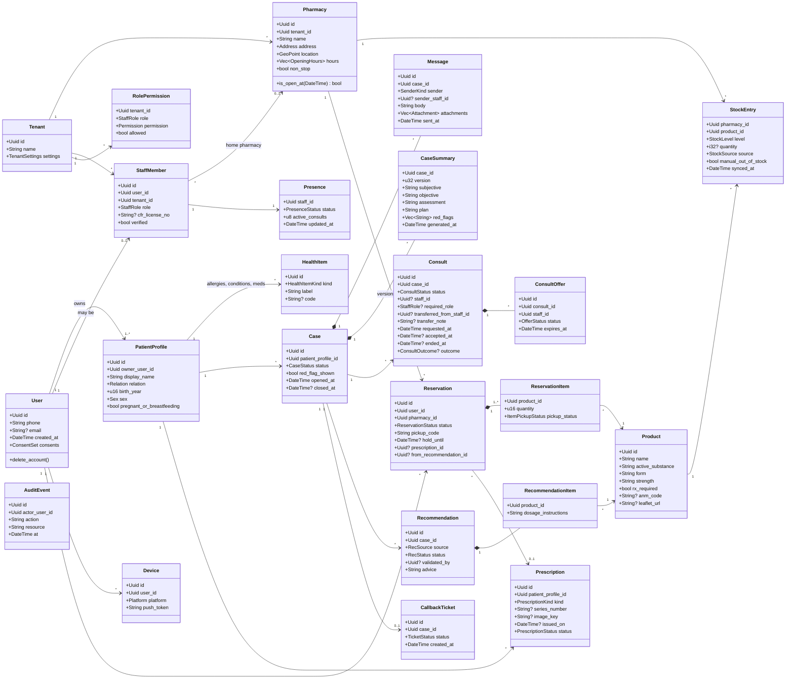
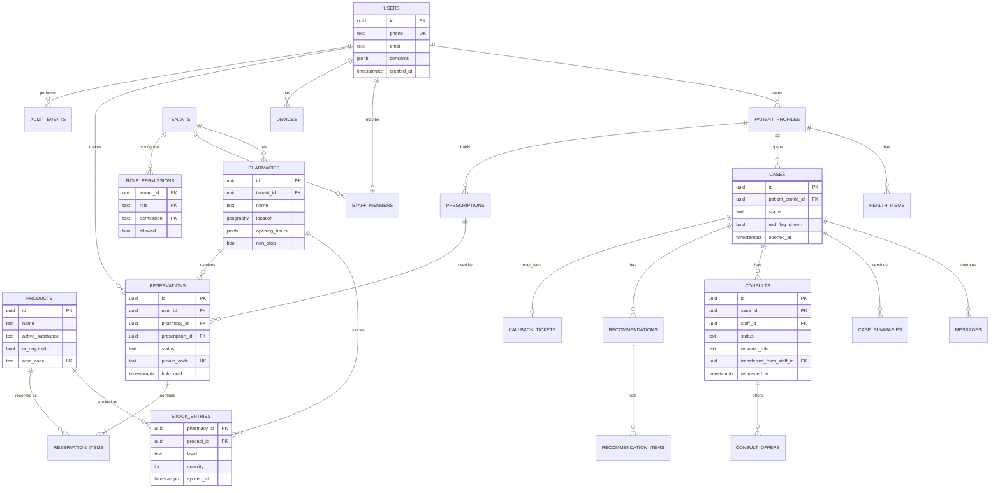

# 05 — Domain Model (UML)

> Logical model. Field lists are indicative: enough to reason about the design, not the final SQL.
> Bounded contexts (→ Rust modules, see doc 06): **Identity**, **Organization**, **Catalog & Stock**, **Care** (cases, consults), **Availability** (opening hours, presence), **Reservations**, **Notifications**, **Audit**.

---

## 1. UML class diagram

---

## 2. Enumerations

| Enum | Values |
|---|---|
| `Relation` | Self, Child, Parent, Partner, Other |
| `HealthItemKind` | Allergy, Condition, CurrentMedication |
| `StaffRole` | Pharmacist, PharmacyAssistant, ChainAdmin |
| `StockSource` | Connector, CsvUpload, ManualFlag |
| `StockLevel` | Available, Low, OutOfStock, Unknown |
| `CaseStatus` | OpenAi, EmergencyShown, WaitingHuman, WithHuman, CallbackPending, Closed |
| `SenderKind` | Patient, Ai, Staff, System |
| `ConsultStatus` | Requested, Waiting, Offering, Active, Transferring, Completed, Cancelled, Expired, CallbackPending |
| `Permission` | AcceptConsult, ValidateOtcRecommendation, AnswerRxQuestions, VerifyRxAtPickup, ProcessReservations, FlagStock |
| `OfferStatus` | Pending, Accepted, Declined, TimedOut, Withdrawn |
| `ConsultOutcome` | Resolved, ReferredDoctor, ReferredEmergency, NoResponse |
| `RecSource` | Ai, Pharmacist |
| `RecStatus` | Draft, PendingValidation, Validated, Overridden |
| `PresenceStatus` | Offline, Available, Busy, Break |
| `ReservationStatus` | Submitted, Confirmed, Ready, PickedUp, PartiallyPickedUp, Rejected, Cancelled, Expired |
| `ItemPickupStatus` | Pending, Handed, RefusedRxInvalid, Unavailable |
| `PrescriptionKind` | Paper, Electronic |
| `PrescriptionStatus` | Registered, VerifiedAtCounter, Refused, Used |
| `TicketStatus` | Open, Claimed, Done |

> **Rust implementation note:** these map naturally to Rust `enum`s. Look at `serde` (`#[serde(rename_all = "snake_case")]`) for JSON, and at `sqlx::Type` for Postgres enums. Enums with data (e.g., an outcome with a reason) are where Rust shines compared to C++.

---

## 3. ER diagram (persistence view)

---

## 4. Design notes

- **Multi-tenancy:** every org-owned table has a `tenant_id` (directly or through `pharmacy_id`). Patients are **platform-level**, not tenant-level: one patient can reserve at any chain later (GDS vision).
- **Case ≈ PNR:** the Case is the central record that travels between the AI, staff and reservations.
- **Summary versions:** every AI update creates a new `CaseSummary` version. Staff see the latest one and can view the history (traceability).
- **Presence is hot data:** stored in **Redis** (fast, expiring), with a snapshot in Postgres for reports.
- **Availability in MVP = opening hours + presence.** No `Shift` / `OnCallWindow` entities yet. They return with Modes B/C (doc 03 §6).
- **Pharmacy team:** pharmacists and assistants are both `StaffMember`s. What each role may do is data (`RolePermission`), not code, so the chain can adjust it after legal confirmation (Q10).
- **Transfer:** the same `Consult` is re-offered with `required_role = Pharmacist`. `transferred_from_staff_id` keeps the trace.
- **Prescription images:** stored in object storage (S3-compatible, EU) with encryption. Only `image_key` lives in the DB. Short-lived signed URLs for staff.
- **Stock:** `level` is what the user sees. `quantity` stays internal (and is optional if the ERP doesn't expose it).
- **Soft vs hard delete:** account deletion = hard delete of personal data + anonymized aggregates kept for statistics (to confirm with legal).
