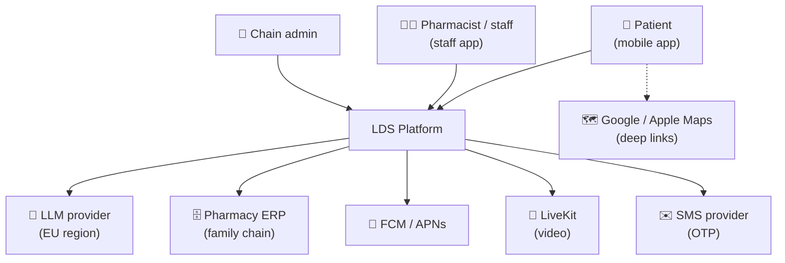
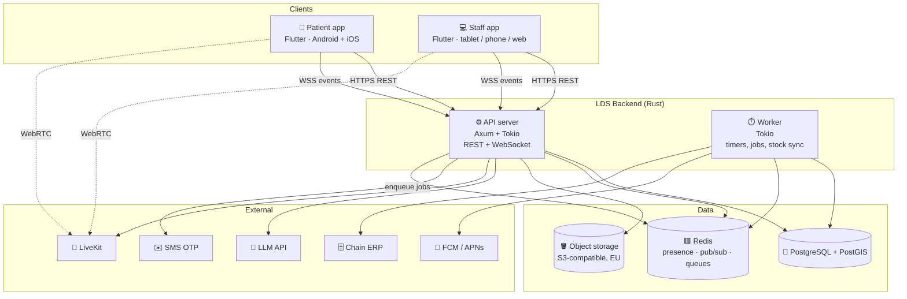
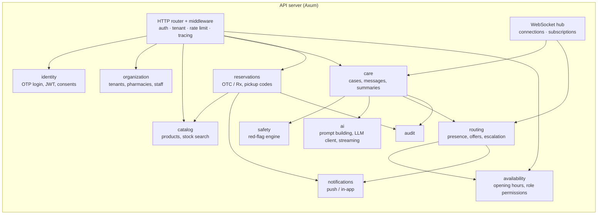
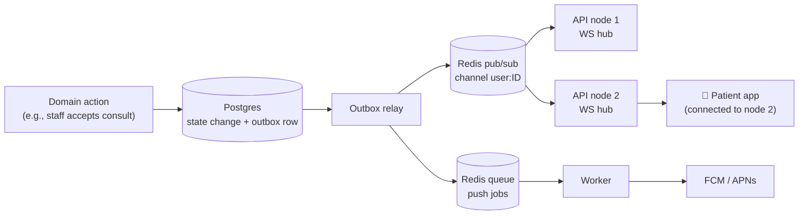
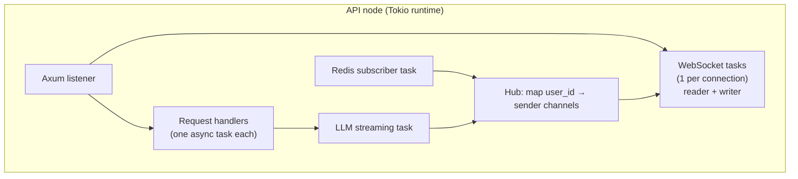

# 06 — Architecture

> Style: **modular monolith in Rust** (one deployable API server + one worker binary, sharing crates).
> Split into services only when a real need appears (scale, team, isolation).

---

## 1. C4 Level 1: System context



## 2. C4 Level 2: Containers



Stock: the worker reads from whatever source the chain's software allows (API, DB, export file), or from an admin CSV upload. See [doc 11](11-stock-integration.md).

**Why two binaries?** The API server handles requests and WebSockets. The worker runs background work (timers, sync, push sending) so slow jobs never block user requests. Both are stateless and scale horizontally.

## 3. C4 Level 3: Components (modules in the API server)



---

## 4. The async model (the important part)

Requirement: *"chat connecting while the user is navigating the app"* plus many concurrent things (AI streaming, offers, timers, push).

### 4.1 Principles
1. **One WebSocket per logged-in app**, opened at app start and **kept independent of screens**. Any screen can react to events (banner "Pharmacist joined").
2. **Events, not polling.** The server pushes typed events (`consult.accepted`, `message.new`, `reservation.ready`…). See doc 09.
3. **Push notifications as a fallback** when the app is in the background or the socket is down.
4. **Every async process is a state machine persisted in Postgres** (doc 08), so a crash or restart never loses a consult or a reservation.
5. **Timers live in the worker** (offer reminders, max-wait, reservation expiry, opening 08:00 / closing 20:00), backed by Redis / Postgres, never in a single process's memory only.
6. **Multi-instance ready:** when there are 2+ API nodes, a message for user X may arrive at node 1 while X is connected to node 2 → **Redis pub/sub** fans events out to all nodes.

### 4.2 Event flow



The **transactional outbox** (state change and event row written in the same DB transaction) guarantees that no event is lost and none is emitted for a rolled-back change.

### 4.3 Inside one API node (Tokio)



> 🦀 **Rust learning hints (no code yet):**
> - `tokio::spawn`: lightweight tasks (like goroutines). Thousands are cheap.
> - `tokio::sync::mpsc`: one channel per WebSocket connection (hub → writer task).
> - `tokio::sync::broadcast`: one-to-many in-process fan-out.
> - `Arc<...>` + `DashMap` or `RwLock<HashMap>` for the hub's shared map. Compare `Arc` with C++ `std::shared_ptr`.
> - `tokio::select!` waits on "new WS message OR new hub event OR shutdown" at the same time.
> - `axum::extract::ws` for WebSockets, `axum::extract::State` to share app state.
> - LLM streaming: `reqwest` + a byte stream (`futures::StreamExt`) → forward chunks to the hub.

---

## 5. Proposed Rust workspace layout

```
lds/
├── Cargo.toml                # [workspace]
├── crates/
│   ├── domain/               # pure types + business rules: entities, enums, state machines (no I/O)
│   ├── app/                  # use cases / services, orchestrating domain + ports (traits)
│   ├── infra/                # adapters: Postgres (sqlx), Redis, LLM client, LiveKit, FCM, S3, ERP
│   ├── api/                  # binary: Axum router, handlers, WebSocket hub, auth middleware
│   ├── worker/               # binary: timers, outbox relay, push sender, stock sync
│   └── safety/               # red-flag engine (rules + test suite), isolated and heavily tested
├── migrations/               # SQL migrations (sqlx migrate)
└── tests/                    # integration tests (testcontainers: Postgres, Redis)
```

**Hexagonal / ports & adapters:** `domain` and `app` define **traits** (e.g., `StockRepository`, `LlmClient`, `PushSender`). `infra` implements them. This keeps the business logic testable without a database, and it's a great way to learn Rust traits and generics (≈ C++ abstract classes / concepts).

## 6. Mobile app architecture (Flutter, proposed)

| Layer | Choice (proposal) |
|---|---|
| State management | Riverpod |
| Navigation | go_router |
| HTTP | dio |
| WebSocket | `web_socket_channel` + a global **RealtimeService** (singleton, auto-reconnect, exponential backoff) |
| Push | firebase_messaging (FCM + APNs) |
| Video | livekit_client |
| Maps | google_maps_flutter / apple maps via url_launcher deep links |
| Local storage | drift (SQLite) for offline cache + outbox of unsent messages |
| Models | Generated from the API's OpenAPI spec (shared contract) |

The **global RealtimeService** is what makes "chat connects while I browse" work: it lives above all screens, receives events and updates the app state. Any screen shows a banner or badge.

## 7. Deployment (pilot)

| Component | Pilot proposal |
|---|---|
| Hosting | EU cloud (e.g., Hetzner / OVH / AWS eu-central-1), one region |
| Runtime | Docker containers: `api` ×2, `worker` ×1 |
| DB | Managed PostgreSQL 16 + PostGIS, daily backups, PITR |
| Redis | Managed Redis 7 |
| Video | LiveKit Cloud (start) → self-host later if cost requires |
| CI/CD | GitHub Actions: fmt, clippy, tests, build images, deploy |
| Observability | OpenTelemetry → Grafana / Loki / Tempo (or a managed equivalent) |
| Secrets | Cloud secret manager. Never in the repo |

## 8. Security & privacy architecture

- **Auth:** phone OTP → short-lived access JWT (15 min) + rotating refresh token. Staff: same, plus a role and tenant claims. 2FA for admins.
- **Authorization:** RBAC + tenant isolation enforced in the `app` layer (and optionally Postgres row-level security).
- **Health data access:** staff can read a Case **only** if they have an active/assigned Consult or callback for it. Every read is audited.
- **AI provider:** EU data residency, zero data retention agreement, pseudonymized context (no phone or name sent to the LLM).
- **Encryption:** TLS 1.2+, encryption at rest (DB, object storage). Prescription images get short-lived signed URLs.
- **Red-flag engine runs locally** (no external dependency), so it works even when the LLM is down.
