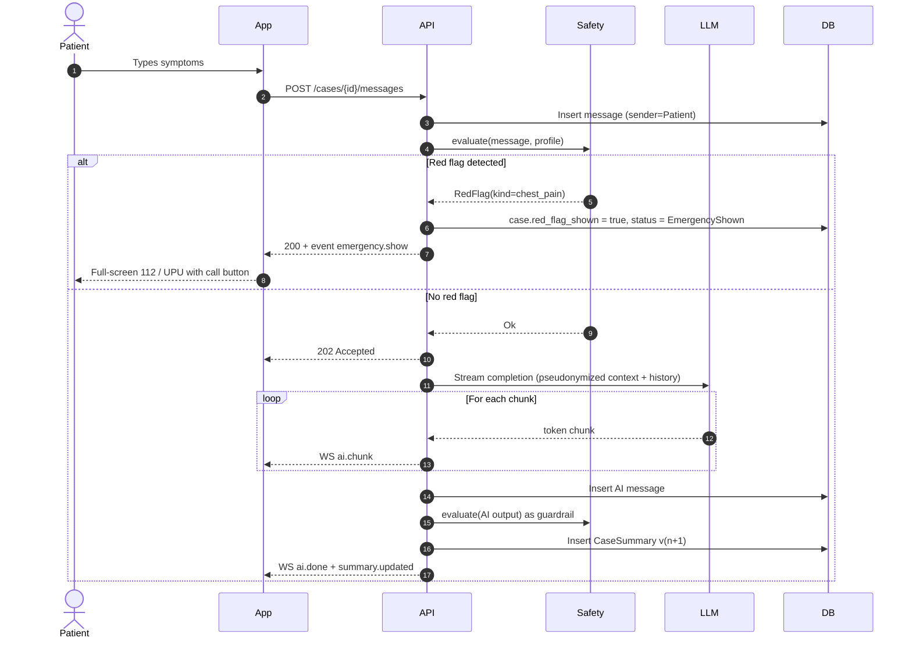
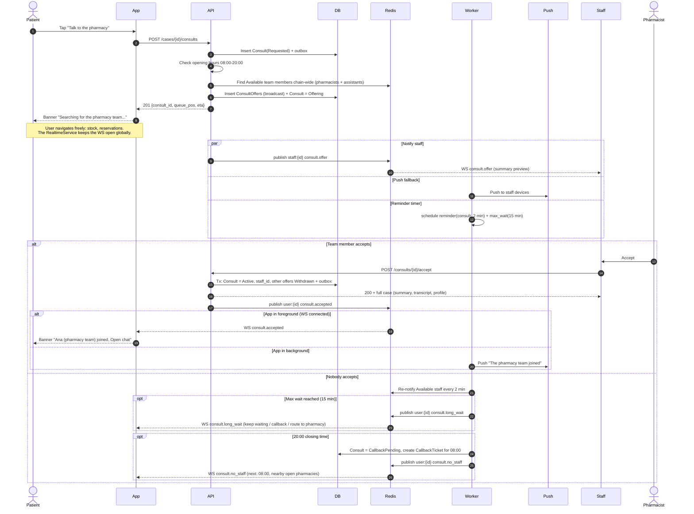
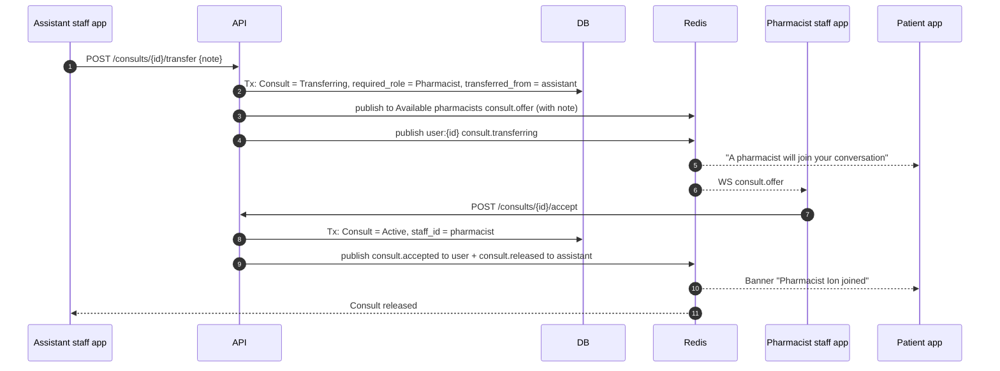
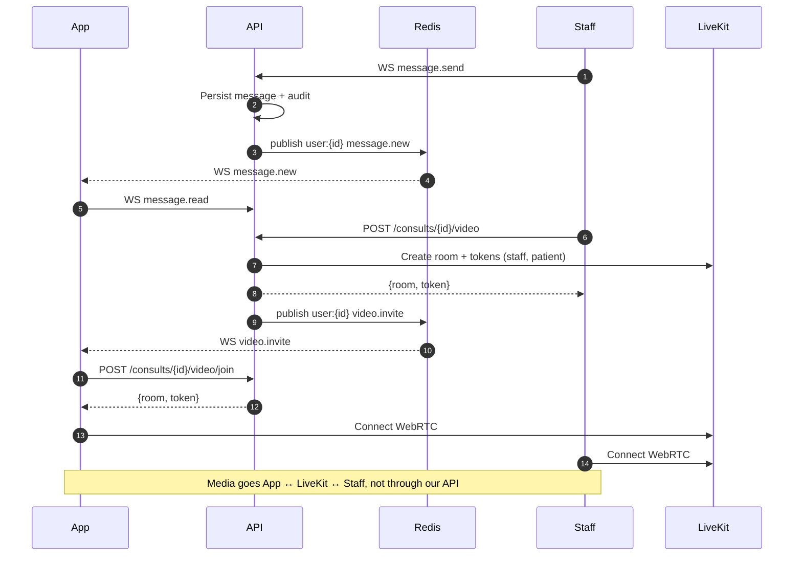
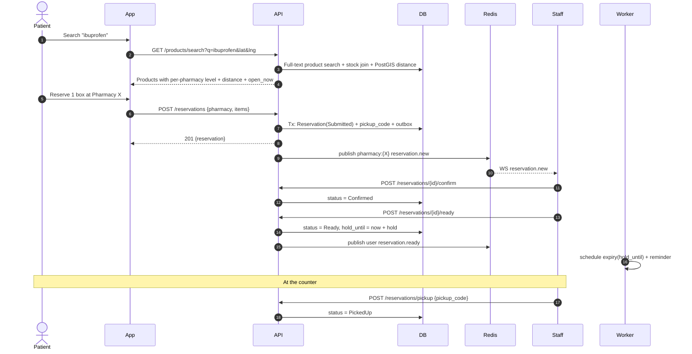
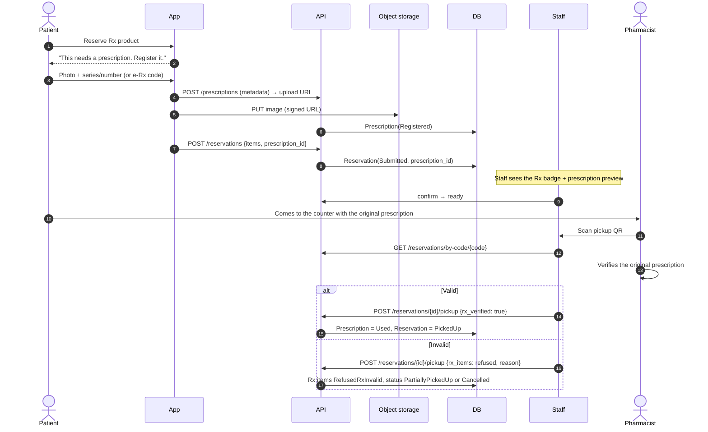
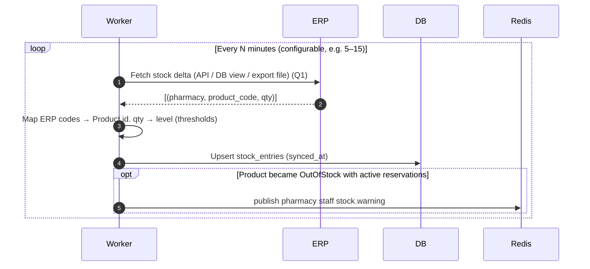
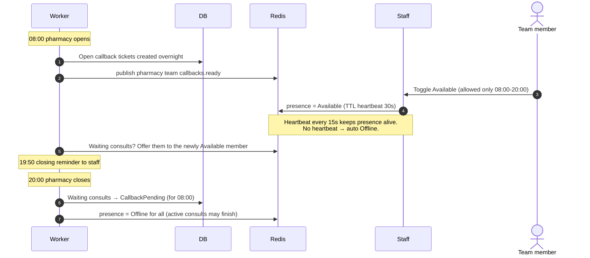

# 07 — Sequence Diagrams

> Participants: **App** (Flutter patient app), **Staff** (staff app), **API** (Axum server), **WS** (WebSocket hub), **Safety** (red-flag engine), **LLM**, **DB** (Postgres), **Redis**, **Worker**, **Push** (FCM/APNs), **LK** (LiveKit), **ERP**.

---

## SD-1 AI consultation with red-flag check (UC-03, UC-04)

## SD-2 Async handoff to a pharmacist while the user browses (UC-05)

## SD-2b Transfer from assistant to pharmacist (UC-31)

## SD-3 Chat and upgrade to video (UC-06)

## SD-4 Stock search + OTC reservation (UC-08, UC-10)

## SD-5 Rx reservation with prescription at the counter (UC-11, UC-30)

## SD-6 Stock synchronization (worker ↔ ERP)

## SD-7 Opening / closing time and presence

