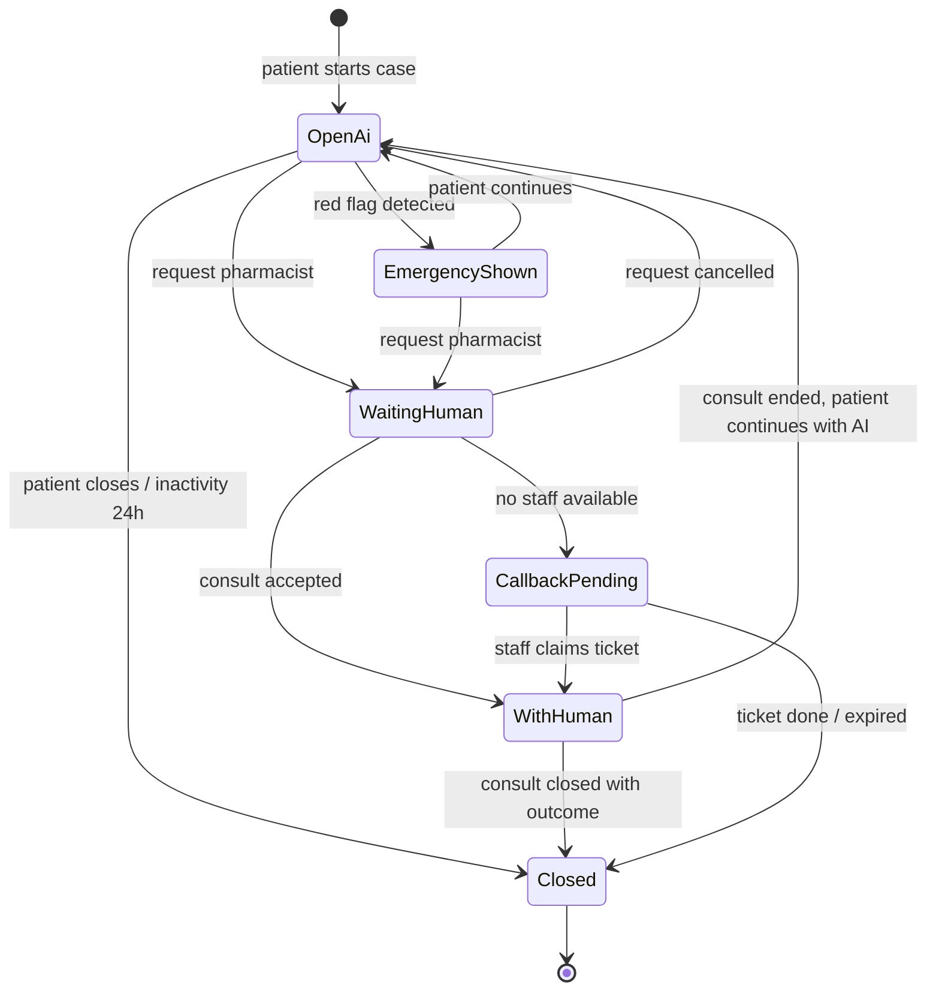
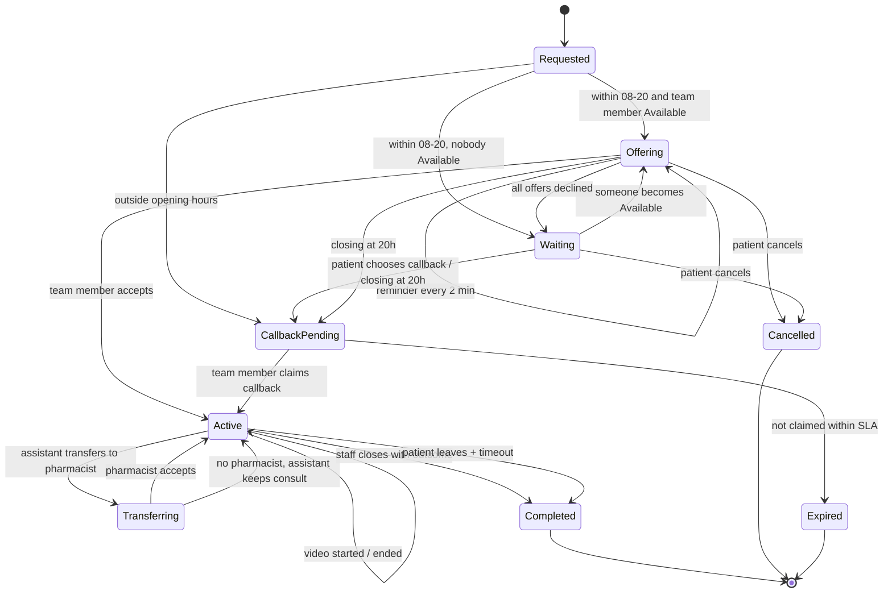
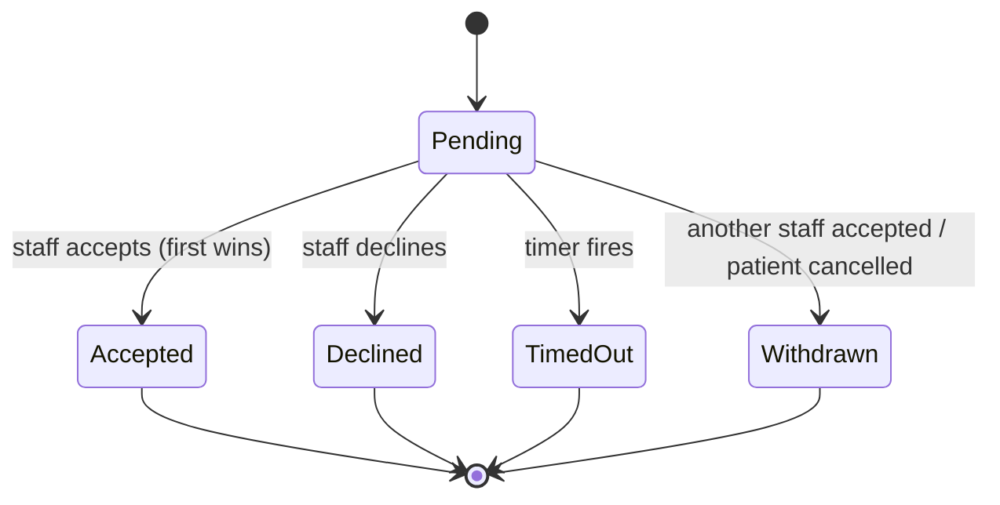
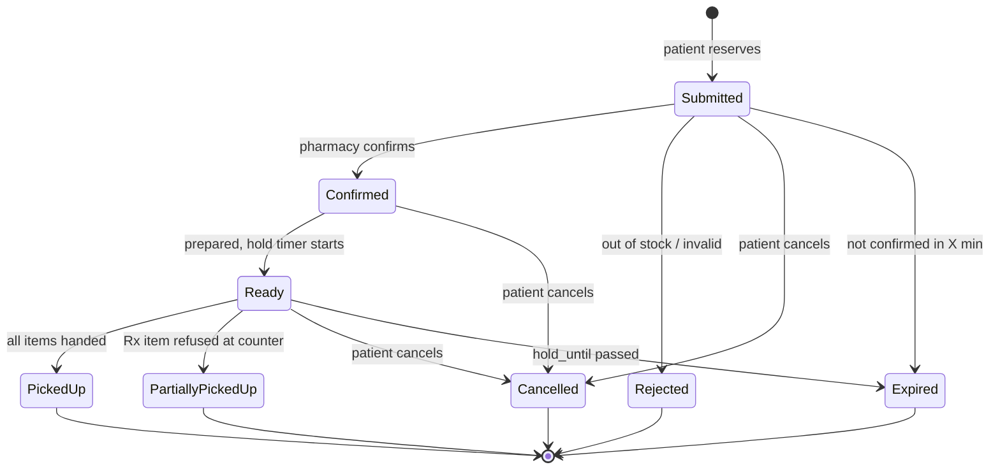
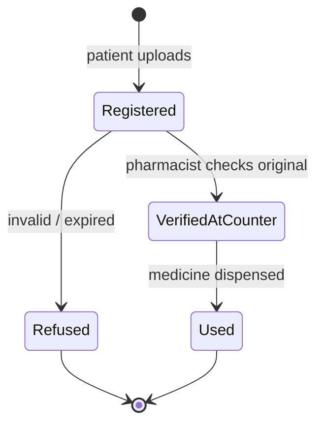
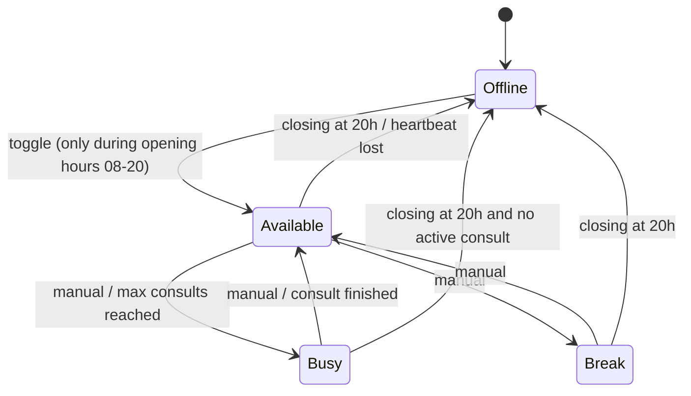
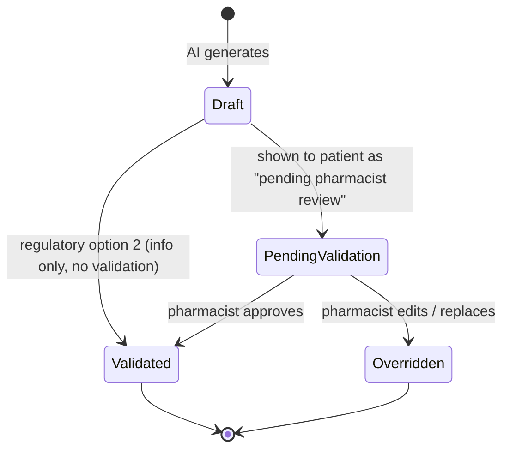

# 08 — State Machines

> Each of these is persisted in Postgres. Transitions happen in the `domain` crate as pure functions:
> `fn transition(state, event) -> Result<NewState, DomainError>`.
> 🦀 **Rust hint:** model states as an `enum` and transitions with `match (state, event)`. The compiler forces you to handle every combination, which C++ `switch` won't.

---

## 1. Case

## 2. Consult (handoff)

## 3. Consult offer (per staff member)

> ⚠️ **Concurrency:** two pharmacists can tap "Accept" at the same time. Solve it in the DB:
> `UPDATE consults SET status='active', staff_id=$1 WHERE id=$2 AND status='offering'`. Exactly one gets `rows_affected = 1`. (This is a nice first exercise in optimistic concurrency with `sqlx`.)

## 4. Reservation

## 5. Prescription

## 6. Staff presence

## 7. Recommendation (human-in-the-loop option)

