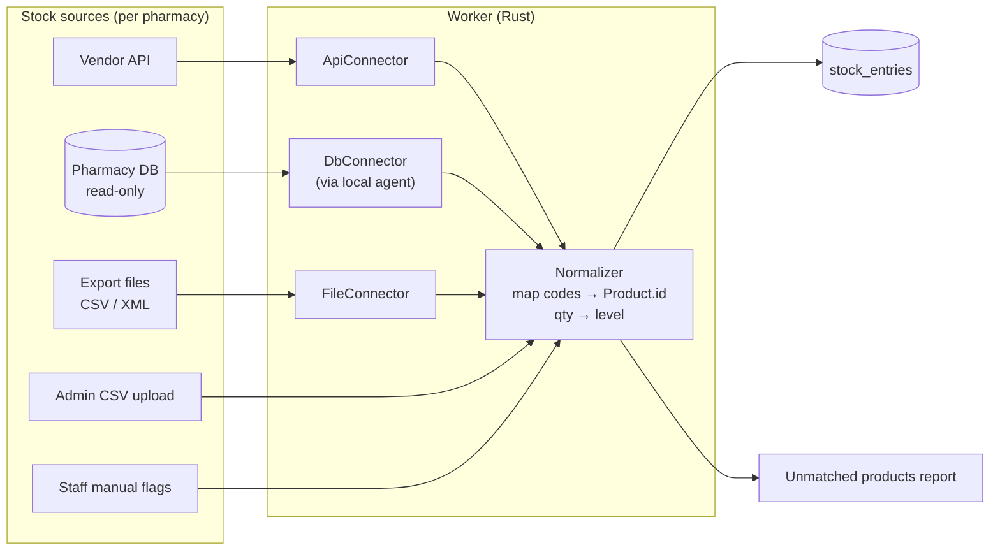

# 11 — Stock Integration

> **Status:** ❓ Unknown how the chain's pharmacy software exposes stock. **Founder to verify** (Q1).
> **Design principle:** the platform doesn't depend on one integration method. A **stock connector** abstraction lets us plug in whatever the chain's software allows, and there's a **manual fallback** that works from day one.

---

## 1. Checklist: what to ask (pharmacy manager / IT / software vendor)

### About the software
- [ ] **Name and version** of the pharmacy management software (ERP / POS) used in each pharmacy.
- [ ] Is it the **same software in all 2–3 pharmacies**?
- [ ] Is it **local** (a server in each pharmacy) or **cloud / central** (one database for the chain)?
- [ ] Who is the **vendor**, and is there a support contact?

### About access to stock data
- [ ] Does the vendor offer an **API** (REST/SOAP) for stock? Documentation? Cost?
- [ ] Can it **export** stock automatically (CSV / XML / Excel) on a schedule (e.g., every 15 min, hourly, nightly)? Where to: a folder, FTP, email?
- [ ] Is a **read-only database access** (or a database view) possible? Which DB engine (SQL Server, Firebird, PostgreSQL…)?
- [ ] Does the chain already send stock somewhere else (e.g., to a distributor, a website, a central office)? That channel could be reused.

### About the data itself
- [ ] Which **product identifier** is used: internal code, **ANM code**, **EAN barcode**, CIM code? (needed to map to our catalog)
- [ ] Do we get **quantity**, or only available / not available?
- [ ] Are **reserved** quantities handled in the software? Can we write a reservation back (optional, later)?
- [ ] How fresh is the data? (real time, minutes, end of day?)

### About the contract / legal side
- [ ] Is the chain **allowed by its contract with the vendor** to extract data / use an API?
- [ ] A data processing agreement is needed if the vendor's system is involved.

---

## 2. Integration options (from best to simplest)

| # | Option | Freshness | Effort | Notes |
|---|---|---|---|---|
| 1 | **Vendor API** | Real time / minutes | Medium | Best long-term. May cost money |
| 2 | **Read-only DB access / view** | Minutes | Medium | Needs a small agent near the DB if the DB is local (no public exposure) |
| 3 | **Scheduled export file** (CSV/XML) → upload / SFTP / watched folder | 15 min – daily | Low | Very common in Romanian pharmacy software. Robust |
| 4 | **Manual CSV upload** in the admin panel | When someone uploads | Very low | ⭐ **Day-one fallback**. Works for any software that can export to Excel |
| 5 | **Manual stock flags** in the staff app ("out of stock" toggle for top products) | Live, partial | Very low | A complement to the others, for fast-moving products |

**MVP plan:** build the **connector interface + option 4 (CSV upload) + option 5 (manual flags)** first. Then add option 1, 2 or 3 once Q1 is answered.

---

## 3. Architecture



> 🦀 **Rust hint:** define a trait like `StockSource` with an async method that returns a list of `(pharmacy, product_code, quantity)` rows. Each option is one `impl` of that trait. The worker doesn't care which one it's talking to. This is the hexagonal "port & adapter" idea from doc 06 (≈ an abstract base class in C++, but checked at compile time with generics or used dynamically with `Box<dyn StockSource>`).

---

## 4. Normalization rules

| Rule | Proposal |
|---|---|
| Product matching | Priority: ANM code → EAN → name + strength + form (fuzzy, needs manual confirmation) |
| Level thresholds | `0` = OutOfStock, `1–2` = Low, `≥3` = Available (configurable per product category) |
| Stale data | If `synced_at` is older than X hours → show "availability not confirmed, call the pharmacy" |
| Manual flag vs sync | A manual "out of stock" flag wins until the next sync shows quantity > 0 |
| Unmatched codes | Listed in the admin panel for manual mapping |

## 5. CSV format (fallback, proposal)

```csv
pharmacy_code,product_code,code_type,product_name,quantity
F01,W12345001,ANM,Ibuprofen 400mg 10 cpr,25
F01,5941234567890,EAN,Paracetamol 500mg 20 cpr,0
```
